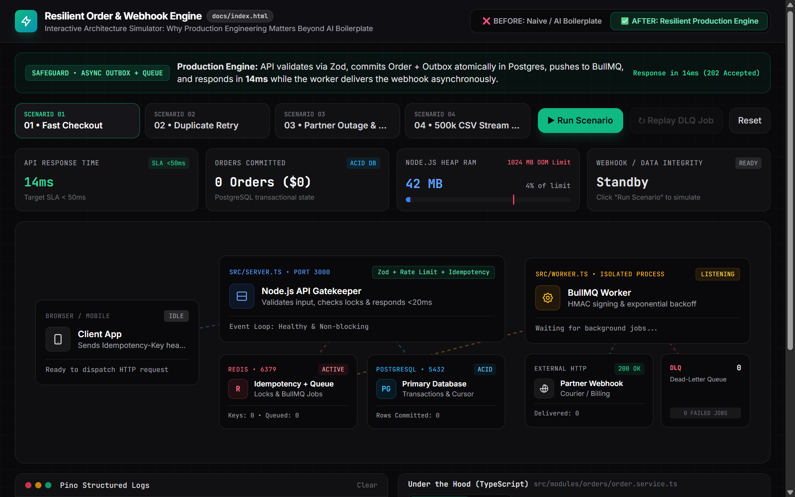

# Resilient Order & Webhook Processing Engine

> **Interactive Simulator (Naive vs. Resilient):**  
> [](https://aminzahin.github.io/resilient-order-engine/)
> **[Launch Live Demo → resilient-order-engine](https://aminzahin.github.io/resilient-order-engine/)**  
> *Switch between a straightforward synchronous setup and this engine to see how it handles duplicate payment retries, flaky third-party webhooks, and 500k-row CSV exports.*

---

## Why I Built This

Scaffolding CRUD endpoints is easy. Especially with modern AI tools. Real backend work starts when things break in production: flaky mobile networks, double clicks, sudden traffic spikes, and heavy exports that blow past memory limits.

I built this project to put core Node.js and reliability patterns in one place:

- **Runtime Validation (`Zod`):** Catches bad inputs early at external boundaries (`req.body`, headers, and environment variables).
- **Idempotency Keys (`Redis`):** Stops duplicate retries from creating double orders or double charges.
- **Atomic Transactions (`PostgreSQL`):** Checks stock, deducts inventory, and creates the order in a single ACID transaction so concurrent requests don't oversell items.
- **Background Jobs (`BullMQ`):** Moves slow outbound webhook calls off the request path, keeping API responses under 20ms.
- **Retries & Dead-Letter Queue (`Exponential Backoff + DLQ`):** Retries failing partner webhooks automatically and parks stubborn failures in a DLQ so they can be inspected and replayed later.
- **Streaming Exports (`Node.js Streams`):** Streams rows from PostgreSQL straight to the HTTP response, keeping memory flat around ~40MB even on 500,000+ rows.
- **Graceful Shutdown (`SIGTERM / SIGINT`):** Finishes open HTTP requests and in-flight worker jobs before the process exits on deploys or restarts.

---

## Naive vs. Resilient at a Glance

| Scenario | Naive Setup | Resilient Engine |
| :--- | :--- | :--- |
| **Double-tap on spotty Wi-Fi** | Can create duplicate orders or charge twice. | **Redis idempotency key** catches the retry and returns the saved response. |
| **Checkout API latency** | Often 3–10s while waiting on external webhooks. | **Under 20ms (`202 Accepted`)**; webhooks run asynchronously in **BullMQ**. |
| **Partner webhook endpoint is down** | Request fails (`500` or timeout) and the event is lost. | Retries with **exponential backoff** (2s → 4s → 8s), then moves to a **DLQ**. |
| **500,000-row CSV export** | Buffers rows in memory and risks an **OOM crash**. | Streams data with **Node.js Readable Streams** (~40MB memory footprint). |
| **Rolling out a new release** | In-flight writes or jobs can get cut off mid-run. | **Graceful shutdown (`SIGTERM`)** drains active work before exiting. |

---

## Request Lifecycle

```mermaid
sequenceDiagram
    autonumber
    actor Client
    participant API as Express API
    participant Redis as Redis (Idempotency & Queue)
    participant DB as PostgreSQL (ACID)
    participant Worker as BullMQ Worker
    participant Partner as Partner Webhook

    Client->>API: POST /orders (Header: Idempotency-Key)
    API->>Redis: Check Idempotency-Key
    alt Already processed
        Redis-->>API: Return cached response
        API-->>Client: 200 OK (Deduplicated)
    else First attempt
        API->>DB: BEGIN TX (Check & deduct stock + insert order)
        DB-->>API: COMMIT
        API->>Redis: Cache response (24h TTL) & enqueue webhook job
        API-->>Client: 202 Accepted (less than 20ms)
    end

    Worker->>Redis: Pull webhook job
    Worker->>Partner: POST webhook (HMAC-SHA256 signature)
    alt 500 or timeout
        Partner--xWorker: Delivery failed
        Note over Worker,Redis: Retry with backoff (2s -> 4s -> 8s) -> DLQ
    else 200 OK
        Partner-->>Worker: Delivered
    end